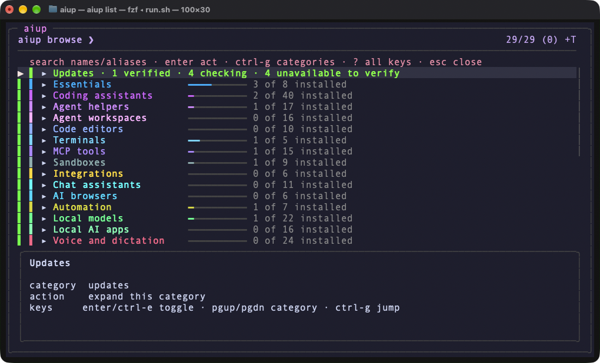
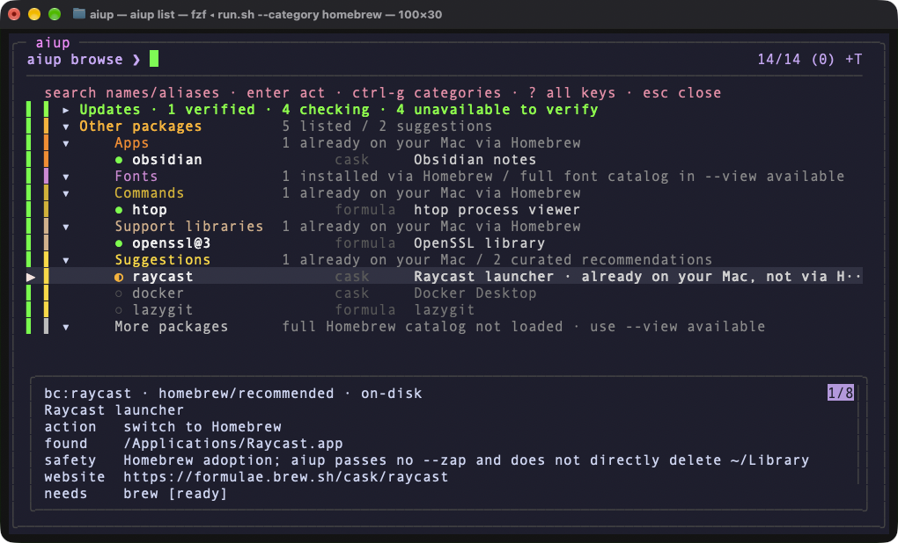
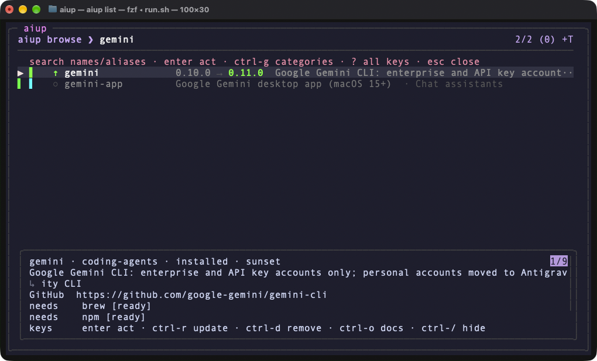
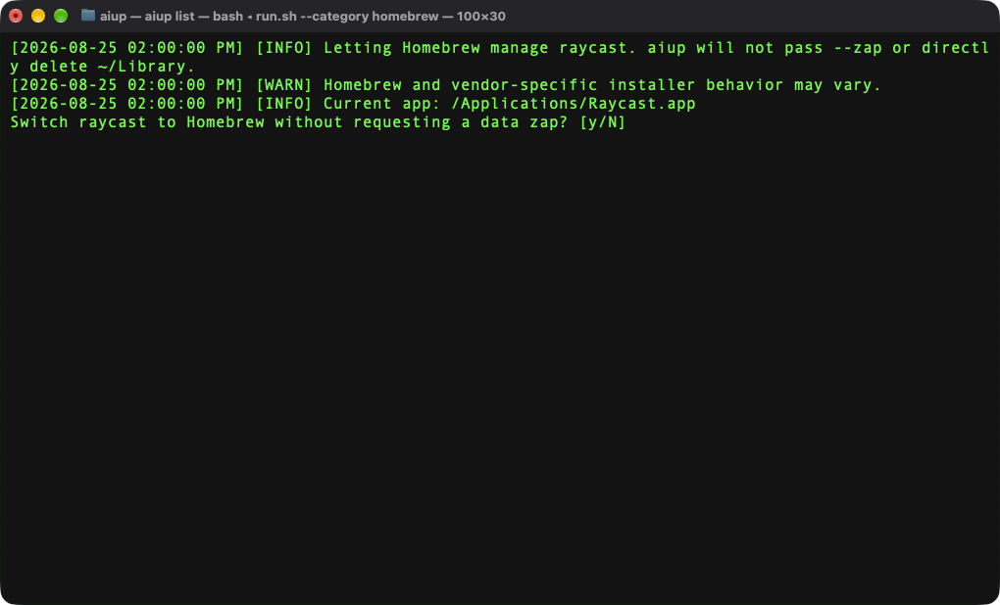
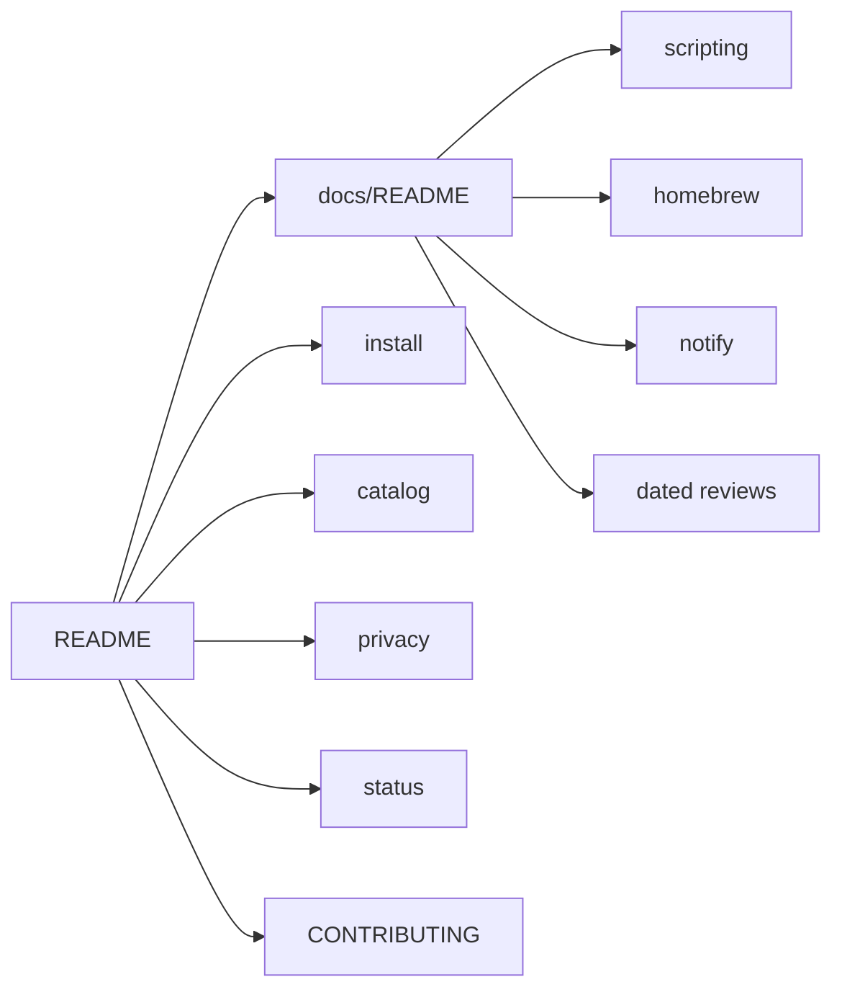

<p align="center">
  
</p>

<p align="center">
  <strong>A macOS-only TUI to scan, update, install, remove, and browse reviewed AI and developer tools.</strong><br/>
  Inventory stays on your Mac. The public launcher runs the latest published release and keeps working offline.
</p>

<p align="center">
  
  
  
  
</p>

<p align="center">
  <a href="https://aiup.neuman.dev">🌐 aiup.neuman.dev</a>
  ·
  <a href="https://github.com/travisjneuman/aiup">⭐ GitHub</a>
  ·
  <a href="docs/install.md">⬇️ Install</a>
  ·
  <a href="docs/catalog.md">📚 Catalog</a>
  ·
  <a href="docs/privacy.md">🔒 Privacy</a>
  ·
  <a href="docs/status.md">🗺️ Status</a>
  ·
  <a href="CONTRIBUTING.md">🤝 Contribute</a>
  ·
  <a href="SECURITY.md">🛡️ Security</a>
</p>

---

<p align="center">
  <picture>
    <source media="(prefers-reduced-motion: reduce)" srcset="docs/media/aiup-list-poster.png?v=20261014-04" />
    
  </picture>
</p>

<p align="center"><em>⏎ install or expand &nbsp;·&nbsp; ⌃D uninstall &nbsp;·&nbsp; ⌃O docs &nbsp;·&nbsp; esc done</em></p>

**Contents:** [One minute](#-one-minute) · [Ground rules](#-ground-rules) · [Keys](#-keys) · [Already installed](#-already-installed-just-not-via-homebrew) · [Catalog](#-whats-in-the-catalog) · [What aiup needs](#-what-aiup-needs) · [Status](#-status) · [Everyday commands](#everyday-commands) · [AppCleaner](#apps-removed-with-appcleaner) · [Documentation map](#documentation-map) · [License](#-license)

## ⚡ One minute

```bash
curl -fsSL https://raw.githubusercontent.com/travisjneuman/aiup/main/macos/install-aiup | bash
export PATH="$HOME/.local/bin:$PATH"
aiup only fzf
aiup list
```

| You type | What happens |
|---|---|
| `aiup` | 🔍 Ensure fzf → update installed catalog tools **and Homebrew extras** |
| `aiup list` | 🎛️ Full-screen catalog |
| `aiup check` | Read-only availability report with what's new in each update; accepts optional tool names |
| `aiup notify` | Check, then show a macOS notification when updates are ready ([schedule it yourself](docs/notify.md)) |
| `aiup explain remotion` | Show detection, manager, location, and next action |
| `aiup history` | Recent update results; optionally filter by tool |
| `aiup logs remotion` | Read just that tool’s output from its latest saved run, in a pager |
| `aiup only grok` | 📦 Install or update one tool |
| `aiup remove grok` | 🗑️ Remove one managed tool; its settings and sessions are named first and moved to Trash |
| `aiup doctor` | 🩺 Conflicts and setup warnings; `--details` retains full detection detail |

Normal `aiup`, `aiup full`, `aiup core`, and `aiup check` include installed Homebrew formulae, libraries, fonts, and casks outside the curated catalog. Catalog aliases appear once, retaining their exclusions and holds. Detected-only software and manual-update apps still require their owning updater. `aiup only` and named groups remain scoped.

Installed-version reads run concurrently (half the Mac's cores, 2 to 6 workers; `AIUP_CHECK_WORKERS` overrides). Homebrew availability uses one shared snapshot; confirmed-current packages avoid repeated inventory scans. Before the first Homebrew upgrade, aiup downloads every outdated formula and cask it is about to upgrade in one `brew fetch`, so Homebrew downloads them in parallel; the upgrades themselves still run one at a time, and open apps are left out of that download (`AIUP_BREW_PREFETCH=0` turns it off). Once Homebrew's upgrades start, plain npm tools and uv tools update in two background lanes beside them, one tool at a time in each, and their results join the report in the usual order. Tools with their own updater still run one at a time. Node and uv update first, so the lanes use the new versions, and a lane is not started while the run still has to upgrade what it runs on (Node for npm; uv or a Python for uv) or a Homebrew formula those need, such as icu4c or openssl. `AIUP_PARALLEL=0` runs everything one at a time. App shutdown and replacement can still dominate a run; `--timings` exposes those phases.

After each update run, aiup clears the download caches it filled: Homebrew's old versions and downloaded installers, npm's package cache and its debug logs, and uv's cache. It also deletes previous versions that installers keep beside the current one (older Claude Code and Cursor Agent versions, Antigravity's `agy.*.old` copies), and once a day prunes pnpm's shared package store of packages no project uses. It skips a cache while another brew, npm, uv or pnpm process is using it, and leaves a version that is still open in a running program for the next run. The last line says how much space came back. Set `AIUP_CLEANUP_CACHES=0` to keep them.

Supply-chain checks during a run:

- **npm provenance.** If the installed version of an npm tool was published with a provenance record (a signed note from the build service saying which source and build made it) and the new version has none, aiup explains that, names who published each version, links the release page and asks before installing. Without a terminal it leaves the tool alone and says so. `AIUP_NPM_PROVENANCE_CHECK=0` turns this off.
- **npm install scripts.** npm 11.19 and newer hold back install scripts by default. aiup lets through only the ones each tool needs (for example esbuild and workerd for Wrangler).
- **Homebrew attestations.** When the GitHub CLI (`gh`) is installed and signed in, aiup has Homebrew check each bottle's signed build attestation. Without `gh` or a sign-in it stays off, so Homebrew never installs `gh` on its own. `AIUP_BREW_ATTESTATIONS=0` turns it off.

Each update run ends with one color-coded table. Current rows (unchanged tools and apps that updated themselves) are hidden by default; warnings, changes, skips, and failures stay visible. A tool whose version went down, which Homebrew can do when it repoints a formula, shows as `downgraded`. Use `aiup --show-unchanged` for the full table; saved history always retains every result. The last line suggests `aiup resume` only when something is unfinished and `aiup attention` only when something needs a look.

The table shows: tool, outcome, and version. Actual changes show `before → after`; unchanged versions, skips, failures, and unavailable versions remain distinct. Skip reasons and provider warnings appear beneath the relevant row. The report uses the catalog palette, stacks neatly in narrow terminals, and respects `NO_COLOR` and redirected output.

Routine installer output is saved in a private run log under `~/.local/share/aiup/logs/`; `aiup --verbose` also streams it. A **!** marks tools with provider warnings even when their version is unchanged. Blocked setup scripts receive an explicit review message and a tool-log command. Dry runs are labeled **planned**, never updated.

A removed app with a leftover Homebrew receipt is skipped with an explanation; AIUP does not silently reinstall it or erase the receipt. The Updates category includes informational rows for checks that could not finish, so an unsuccessful check is visible even when no updates were confirmed.

Each category heading shows its name, a ten-cell bar for how much of it is on your Mac, and a count such as `3 of 12 installed`. Detected commands include owner, description, metadata-based version evidence, and update guidance where recognizable. See [command insights](docs/command-insights.md).

New maintenance controls:

```bash
aiup check --timings               # see where read-only checking spends time
aiup coverage                      # compact support and detection gaps
aiup coverage --all                # expand all installed and detected rows
aiup doctor                        # PATH conflicts, duplicates, setup warnings
aiup doctor --details               # comprehensive legacy detection detail
aiup exclude remotion              # persistently skip its updates
aiup include remotion              # restore updates
aiup hold remotion 2026-09-30       # skip through this date, inclusive
aiup unhold remotion
aiup group set video remotion ffmpeg macwhisper
aiup group check video
aiup group run video               # update installed members; honor preferences
aiup retry                         # retry failed or deferred tools from the latest inactive run
aiup project /path/to/project       # read declared npm dependency ranges only
aiup export my-mac.json            # save tools, Homebrew packages and preferences
aiup import my-mac.json            # on another Mac: show what it adds, ask, install
aiup check --json                  # results as JSON for your own scripts
```

`--json` prints a run's or a check's results as JSON on stdout. Exit status is 0 when everything worked, 1 when something failed, 2 for a mistyped command and 130 after Ctrl-C. A mistyped command gets one line pointing to `aiup help`. See [scripting and moving to another Mac](docs/scripting.md).

Preferences are local in `~/.local/share/aiup/preferences.json`. Exclusions and holds apply to CLI and picker updates, including `--force`; remove a preference explicitly to resume. Holds expire after the indicated local calendar date. A held missing prerequisite stops dependent work. Named groups do not install absent members by default. `--dry-run` also prevents preference writes. No preferences are enabled on your behalf. `retry` may reinstall a failed absent tool; use `--no-install retry` to prevent that.

Search ranks exact names, aliases, name prefixes, then descriptions. Multiple words must all match the name, package, description or category name, so `voice` lists every dictation and speech tool and `sandbox` finds the sandboxes. Status text does not create hits. Headings hide while you search, so each hit ends with the name of its category. Clear the query to return to category browsing.

Media work is split four ways. **Creative apps** (`media`) holds Remotion and the editors and recorders: Blender, OBS, GIMP, Krita and the rest. **Voice and dictation** (`voice`) holds dictation apps, meeting note takers, Whisper and Parakeet transcription, and text-to-speech. **Image and video AI** (`image-gen`) holds Comfy Desktop, Draw Things, LTX Desktop and mflux. **Media tools** (`media-tools`) holds ffmpeg, ImageMagick, yt-dlp and the other converters. The Creative apps category also recognizes five installed apps with **manual update** guidance: Final Cut Pro, Motion, Pixelmator Pro, Darkroom, and Luminar AI. Those remain inspect-only, are excluded from managed counts, and never enter automated updates. `--view managed` hides manual rows; `--view detected` retains them in the inventory. Catalog availability does not install apps, download models, or confer vendor licenses. See the [category and maintenance review](docs/media-and-maintenance-2026-09-04.md) and [media expansion review](docs/media-expansion-2026-09-04.md).

AIUP retains the latest **20 completed runs** by default (`AIUP_LOG_LIMIT=1…100` overrides this). Active runs and recent logs from older AIUP versions are protected; interrupted runs remain inspectable. `aiup history [tool]` reads results, and `aiup logs [tool]` reads the latest log or its exact tool section (in `less` when the output is a terminal; `AIUP_NO_PAGER=1` prints it straight through). Log cleanup only touches recognized AIUP run files and never follows symlinks. Logs stay on your Mac.

Npm packages are not reinstalled when fresh provider metadata exactly matches a healthy installation in AIUP’s prefix. Homebrew no-op upgrades are skipped only after a valid post-refresh outdated snapshot. Missing, broken, newer, or unverifiable installations keep the existing update path; `--force` bypasses these shortcuts for repairs. Native updaters and manager-switch rules remain in effect.

`aiup check [tools…]` checks versions without updating software or changing shell profiles. Each tool is compared with the source it installs from: Homebrew's metadata (refreshed when older than 15 minutes) or the vendor's release channel, npm or PyPI, all fetched in one concurrent pass. Availability may use the same short-lived cache as the catalog; add `--refresh` for fresh provider reads. Unsupported or failed checks are **unverified**, not current. Each tool with an update gets a "What's new" line: the release title and first lines from the project's GitHub release, with a link. Release notes are fetched once per version without a GitHub login and cached; `AIUP_RELEASE_NOTES=0` skips them. `aiup explain <tool>` shows the installation manager and why an update is available, skipped, or unverified. Checks may update AIUP’s local metadata cache, but never install tools. See the [maintenance and performance review](docs/maintenance-and-performance-2026-09-04.md) for scope and evidence.

### 🔄 How releases reach your Mac

The installed command runs the latest published release. Each run makes one small request for the release pointer (`macos/release` on `main`), which names the exact commit whose runtime and catalog form the release. Files addressed by commit never change, so the runtime and catalog always match, and work landing on `main` between releases never reaches your Mac. When the release is unchanged, aiup starts immediately with no download. A new release is downloaded, validated, staged as one pair, and activated by atomically switching a single `current-generation` pointer. The former release is deleted once it is more than a day old (an open picker may still use it); `previous-generation` only records which release it was. If GitHub is unreachable or a new download fails validation, aiup says so and runs the last validated release. Only a first run with nothing installed yet needs network access.

Repository contributors can opt into an offline local checkout for one invocation by deliberately setting `AIUP_SOURCE_PATH` to that checkout's `macos/aiup` file. No checkout path is guessed or probed by default.

Normal package updates are unattended: Homebrew package confirmations are accepted automatically, and version checks cannot wait for terminal input. The initial Homebrew bootstrap is the exception and runs its official installer interactively for confirmation and any administrator authentication. A Homebrew tap already installed on the Mac is treated as prior user approval and trusted automatically; a missing tap required by a selected tool prompts before it is added and trusted. Explicit uninstall and on-disk app-switch confirmations also require your approval.

Each tool installs from the official channel that gets new releases first. Homebrew often trails a vendor's release by a few hours to a day, so tools such as Codex, Copilot and Kimi install from npm, Spec Kit and gptme from PyPI, and Claude Code and OpenCode from their own installers. Where a tool has more than one official package, the others are alternates. `aiup channel` lists those tools, `aiup channel TOOL` shows each channel's package and latest version, and `aiup channel TOOL brew|npm|uv|vendor|default` picks one. The next `aiup only TOOL` installs from that channel and then removes the old copy; settings stay.

Official desktop apps that are not Homebrew-managed can declare a lightweight update manifest in the catalog. aiup checks that manifest against the installed bundle version first, downloads the large installer only when a newer release exists, and validates the replacement before activation. Screenpipe uses this path; aiup replaces only its app bundle and does not remove its configured settings or capture paths.

## ✨ Ground rules

<table>
<tr>
<td width="50%">

### 🔍 Removed tools stay removed
Default `aiup` only updates what you have. It won't bring back optional tools you removed. It does restore required infrastructure such as fzf.

</td>
<td width="50%">

### 🚫 No direct sudo
aiup does not invoke `sudo` directly. Its user-prefix installs keep Node CLIs in `~/.local/share/aiup/npm`; Homebrew's official initial installer may separately request administrator authentication.

</td>
</tr>
<tr>
<td>

### 🍺 Homebrew lists
Child lists show what's installed on **your Mac** plus a short recommended set. The rest of Homebrew loads only when you ask for it.

</td>
<td>

### 🔒 Inventory stays local
PATH, app bundles, and package inventory are never uploaded. Runtime and package refreshes still use the network. [Privacy →](docs/privacy.md)

</td>
</tr>
</table>

### 🔎 Software aiup finds but doesn't manage

The managed catalog is curated around reviewed install/update/remove contracts. The picker also discovers four kinds of software that are not yet managed: app bundles, global npm packages, uv tools, and user-facing PATH binaries. Those rows are clearly marked detected-only, counted by source, and kept separate from Homebrew's installed inventory. aiup has not verified an updater/remover contract for them yet, so it will not guess how to update them. Project-local dependencies, temporary `npx` downloads, and agent skills are not global installed tools. Remotion is managed as `@remotion/cli`; individual video projects still need their own matching Remotion dependencies.

<p align="center">
  
  
</p>

<p align="center">
  
</p>

## 🎛️ Keys

| Key | Action |
|---|---|
| <kbd>enter</kbd> | Expand a category, install/update a tool, or **switch an on-disk app to Homebrew** |
| <kbd>tab</kbd> / <kbd>space</kbd> | Check / uncheck |
| <kbd>ctrl</kbd>+<kbd>e</kbd> | Toggle this category |
| <kbd>←</kbd> / <kbd>→</kbd> | Collapse / expand this category |
| <kbd>pgup</kbd> / <kbd>pgdn</kbd> | Jump to the previous / next category |
| <kbd>ctrl</kbd>+<kbd>g</kbd> | Open a searchable category-jump palette |
| <kbd>alt</kbd>+<kbd>e</kbd> / <kbd>alt</kbd>+<kbd>c</kbd> | Expand / collapse all |
| <kbd>ctrl</kbd>+<kbd>r</kbd> | Update the focused item or only the checked verified items |
| <kbd>ctrl</kbd>+<kbd>d</kbd> | Uninstall managed items; preview cleanup for detected apps |
| <kbd>ctrl</kbd>+<kbd>o</kbd> | Open GitHub, the product site, or a Google search for detected software |
| <kbd>ctrl</kbd>+<kbd>/</kbd> | Toggle the preview pane |
| <kbd>?</kbd> | Show every key in the preview pane; moving the cursor returns to the item |
| <kbd>esc</kbd> | Leave |

Type to search for contiguous text (case-insensitive) across the entire catalog, including rows inside collapsed categories; clearing the query restores the compact collapsed overview. The picker remembers its last query and category locally, so reopening it resumes navigation without changing the default collapsed overview. Detected is always the last category. It lists software found on this Mac from every source: apps, npm, uv, and PATH. aiup does not manage updates for these rows, and the list covers more than the Applications folder. Its header shows the total plus app/npm/uv/PATH subtotals. Use `aiup list --category detected` (or another category id) when the full catalog is too large. Detected rows show their source, version, path, and web-search link in the preview. App-bundle rows also support an AppCleaner-style cleanup preview; `aiup cleanup <detected-app-id>` lists exact candidates without changing anything, and `--apply` moves confirmed candidates to Trash.

Updates is the first category. It appears immediately as checking or from a valid installed-version-keyed cache, then refreshes as the existing two provider workers finish. Verified newer items show `installed → available` while provider failures, timeouts, malformed responses, and unfinished checks remain explicitly unverified. Enter or <kbd>ctrl</kbd>+<kbd>r</kbd> updates one row; check several rows and use <kbd>ctrl</kbd>+<kbd>r</kbd> to update only those verified items. `Update all verified items · N` confirms the exact names, revalidates each live item, and runs supported updates sequentially. Cached availability identifies candidates but never authorizes a mutation.

Use `--view installed` for a compact maintenance view, `--view managed` to hide local detections/Homebrew extras, `--view detected` for only software found on this Mac, or `--view available` for Homebrew's available packages. Use `--sort label` when scanning a category alphabetically; the default `--sort id` preserves manifest order. `aiup inventory` uses a five-minute source-aware cache; add `--refresh` after installing or removing software outside aiup.

For Homebrew extras outside the managed catalog, use `aiup list --category homebrew/available` or `aiup list --view available`. The overview intentionally does not load thousands of Homebrew rows: it says “not loaded” so you never see a misleading zero. The full view is generated from the Homebrew taps already on the Mac, places `font-*` casks under `Homebrew > fonts`, and delegates dependency resolution back to Homebrew; managed catalog items remain in their normal categories.

Categories start collapsed, and each has its own color bar. Every row starts with a state mark:

| Mark | Meaning |
|---|---|
| <code>●</code> green | Installed, and aiup manages it |
| <code>◐</code> amber | On disk, installed some other way |
| <code>○</code> gray | Not installed |
| <code>◇</code> | Detected software aiup doesn't manage |
| <code>◆</code> amber | An app you update by hand (manual update) |

Installed rows are bright and the rest are dimmed, so what you have stands out. A tool that is winding down shows its stage (`maintenance`, `sunset` or `archived`) in amber, and installing a sunset tool from the list asks first.

## 🍺 Already installed, just not via Homebrew?

Homebrew takes over the app you already have instead of installing a second copy.

<p align="center">
  
</p>

| State | Meaning |
|---|---|
| <code>●</code> **installed** | Homebrew owns it |
| <code>◐</code> **on disk** | The app or command is already here some other way |
| <code>○</code> **absent** | Not found (recommended list only) |

Press <kbd>enter</kbd> on an **on disk** app to let Homebrew manage it.

- aiup does **not pass `--zap`** or directly delete `~/Library` during this action
- Homebrew and vendor installer behavior can still be app-specific
- If the versions already match, Homebrew **adopts** the existing `.app` (no re-download)
- If they don't, aiup asks Homebrew to replace the app bundle without `--zap`
- Command-line tools already on PATH get a Homebrew copy **alongside**; the original is not deleted

## 📚 What's in the catalog

<!-- CATALOG:START -->
_**2026.10.14-04** · **261** tools in the main catalog. Generated from `macos/aiup`._

| | Category | What | Size |
|---|---|---|---|
| ⚙️ | **Essentials** (`infra`) | Runtimes and installers other tools need | 8 tools |
| 🤖 | **Coding assistants** (`coding-agents`) | Agents that write and edit code in the terminal | 40 tools |
| 🧰 | **Agent helpers** (`agent-tools`) | Add-ons for coding agents: usage reports, specs, task lists, rules | 17 tools |
| 🖥️ | **Agent workspaces** (`workspaces`) | Desktop apps that run and manage coding agents | 16 tools |
| ✏️ | **Code editors** (`editors`) | Places you type code | 10 tools |
| ⌨️ | **Terminals** (`terminals`) | Places you run commands | 5 tools |
| 🧩 | **MCP tools** (`mcp`) | Tools to run, test and connect MCP servers | 15 tools |
| 🛡️ | **Sandboxes** (`sandboxes`) | Containers and sandboxes for running agents apart from your files | 9 tools |
| 🔌 | **Integrations** (`adapters`) | Glue between agents and editors (ACP) | 6 tools |
| 💬 | **Chat assistants** (`chat`) | Cloud chat apps | 11 tools |
| 🌐 | **AI browsers** (`browsers`) | Web browsers with an AI assistant or agent built in | 6 tools |
| ⚡ | **Automation** (`automation`) | General-purpose agents and workflow automation | 7 tools |
| 🧠 | **Local models** (`local-ai`) | Model runtimes and servers that run on your Mac | 22 tools |
| 💻 | **Local AI apps** (`local-apps`) | Desktop apps for running models on your Mac | 16 tools |
| 🎙️ | **Voice and dictation** (`voice`) | Dictation, transcription, meeting notes and speech | 24 tools |
| 🎨 | **Image and video AI** (`image-gen`) | Apps and tools that generate images and video | 6 tools |
| 🎬 | **Creative apps** (`media`) | Editors and recorders for video, images, audio and 3D | 12 tools |
| 🎞️ | **Media tools** (`media-tools`) | Command-line tools for converting and downloading media | 6 tools |
| 🔧 | **AI utilities** (`llm-utils`) | Command-line LLM tools, and converters that turn files into text for models | 11 tools |
| 🛠️ | **Developer tools** (`dev-utils`) | Development, search, data, and deployment utilities | 14 tools |
| 🍺 | **Other packages** (`homebrew`) | Homebrew extras outside the managed catalog, plus a short recommended list | your Mac + recommended |
<!-- CATALOG:END -->

Full list → **[docs/catalog.md](docs/catalog.md)** · Homebrew → **[docs/homebrew.md](docs/homebrew.md)**

These totals count curated manifest entries. They don't include software installed on a Mac, detected-only apps, or Homebrew recommendations. Contributors refresh this table, public catalog files, website counts, and `showcase.json` together with `scripts/sync-public-docs --skip-media`. See [public catalog facts](docs/public-catalog-facts.md).

Research notes → **[2026-10-14 catalog review](docs/catalog-review-2026-10-14.md)** · **[catalog research](docs/catalog-research.md)** · **[dated 83-entry accuracy audit](docs/catalog-accuracy-2026-08-25.md)** · TUI review → **[layout and navigation](docs/tui-research.md)**

## 🧰 What aiup needs

| Need | Why |
|---|---|
| macOS 14+ | Current support baseline, matching Homebrew's supported macOS installation requirements |
| Bash 3+ · Python 3 · curl | Prerequisites checked at startup; aiup cannot bootstrap its own shell, Python runtime, or downloader |
| [fzf](https://github.com/junegunn/fzf) | Required full-screen catalog; aiup installs and updates the Homebrew formula |
| Homebrew + Xcode Command Line Tools | Bootstrapped when fzf or a brew-managed item is requested; the official installer may require administrator authentication |
| Node / uv | Installed on demand only when a selected tool needs them |

Run `command -v bash curl python3` before installing. See the [installation contract](docs/install.md) for PATH persistence, online/offline behavior, local development, and uninstall steps.

## 🗺️ Status

The current macOS tool, public repository, minimal site, and six-state media are complete for this dated scope. I've accepted the current media and site design. aiup is not a finished cross-platform or tagged 1.0 product; Safari, physical-device, screen-reader, assistive-technology, and other formal release-acceptance lanes remain separate future work. See **[scope, completion, and next work](docs/status.md)**.

| Area | Status |
|---|---|
| 🍎 macOS | Current daily-use implementation (`macos/aiup`) |
| 🌐 Site | Live; desktop browser review passed, true 375px review remains unverified |
| 🐧 Linux | Not implemented |
| 🪟 Windows | Not implemented |

## Everyday commands

| Command | What it does |
|---|---|
| `aiup welcome` | First-run guide with cleanup choices and readable command examples |
| `aiup attention` | Missing/moved apps, last-run problems, duplicate commands and ownership gaps with next steps |
| `aiup plan` / `aiup plan --all` | Compact/full action preview; no package changes. Runs a read-only check first, so each tool with an update gets its own card with its release notes. Shows self-updated apps and apps that must be quit first; download sizes remain updater-dependent |
| `aiup owners` | Local installation ownership, paths and maintenance guidance; observations persist locally |
| `aiup duplicates` | Active PATH selection, other distinct copies and bounded direct-reference review; never automatically removes duplicates |
| `aiup channel [TOOL [brew\|npm\|uv\|vendor\|default]]` | Lists tools with more than one install channel, shows a tool's channels and latest versions, or picks the one it installs from |
| `aiup resume` | Retries tools whose newest saved result is pending, deferred (app was open), cancelled or failed, across all retained runs, rechecking current state |
| `aiup settings cleanup auto` / `review` | Automatic cleanup or review-first mode; exclusions also accept `bc:`/`bf:` IDs |
| `aiup cleanup history` | Cleanup results from retained structured run history |
| `aiup --plain welcome` | Colorless guidance; statuses remain readable without color |

Normal terminal runs show the guide once, numbered progress and elapsed time. Ctrl-C stops the command that is running, skips the tools not reached yet and still prints the results. The interrupted tool is recorded as `cancelled` and the rest as pending, so `aiup resume` reruns them. A download starts over; it does not continue from where it stopped. Existing provider updaters determine download behavior. aiup never replaces an open app: it defers that update until you quit the app, then `aiup resume` finishes it. Apps that update themselves (Claude, ChatGPT and other `auto_updates` casks) report `self-updated` (`current (self-updated)` in `aiup check`) when they are already at or past Homebrew's version, and aiup skips the Homebrew download. Guidance wraps to the terminal width, using the picker palette when colors are enabled.

## Apps removed with AppCleaner

In the default automatic cleanup mode, a normal `aiup` run finishes Homebrew uninstall for confirmed missing apps and reports **cleaned**. Holds and exclusions still apply; `--dry-run` only plans the action. `aiup list` and `aiup check` do not remove anything.

`aiup cleanup homebrew` previews Homebrew apps whose explicitly recorded app destinations are all missing. To finish one uninstall, use `aiup cleanup bc:alt-tab --apply` (substitute the displayed name). AIUP checks again immediately before invoking Homebrew's forced cask uninstall. This runs normal uninstall hooks, never `--zap`; it does not delete Homebrew metadata directly. Apps with incomplete destination metadata, partially present multi-app installations, and broken symlinks are not cleanup candidates. Preview is the default; bulk apply is not supported. `brew cleanup` remains a separate cache/old-version operation.

AIUP remembers bundle identities observed at their installed locations, scans common app folders, and checks Spotlight for known identities before considering a missing app removed. A matching moved/renamed app is left for review, not cleaned or reinstalled. Unindexed locations, inaccessible folders and apps removed before their identity was ever observed limit what can be established; use review mode when automatic cleanup is unsuitable. These checks do not establish that every copy anywhere on disk has been found.

## Documentation map

| Need / keywords | Open |
|---|---|
| Every doc, dated reviews | [docs/README.md](docs/README.md) |
| Install, PATH, offline, uninstall | [docs/install.md](docs/install.md) |
| Catalog entries and counts | [docs/catalog.md](docs/catalog.md) · [public catalog facts](docs/public-catalog-facts.md) |
| Homebrew, taps, adoption | [docs/homebrew.md](docs/homebrew.md) |
| Privacy and network boundaries | [docs/privacy.md](docs/privacy.md) |
| Scope, version, next work | [docs/status.md](docs/status.md) |
| JSON, exit status, export and import | [docs/scripting.md](docs/scripting.md) |
| Update notifications, cron, launchd | [docs/notify.md](docs/notify.md) |
| Contribute, report a bug, security | [CONTRIBUTING.md](CONTRIBUTING.md) · [SUPPORT.md](SUPPORT.md) · [SECURITY.md](SECURITY.md) |
| Release history | [CHANGELOG.md](CHANGELOG.md) |



## 📜 License

[MIT](LICENSE) · [Contributing](CONTRIBUTING.md) · [Security](SECURITY.md) · [Support](SUPPORT.md) · [travisjneuman/aiup](https://github.com/travisjneuman/aiup)

Screenpipe backups (my storage policy as of September 29, 2026): official-DMG updates retain
the prior code bundle only through activation. A failed activation restores it;
a successful activation deletes the redownloadable code backup. Recordings,
settings and user data are not part of this backup or cleanup.
