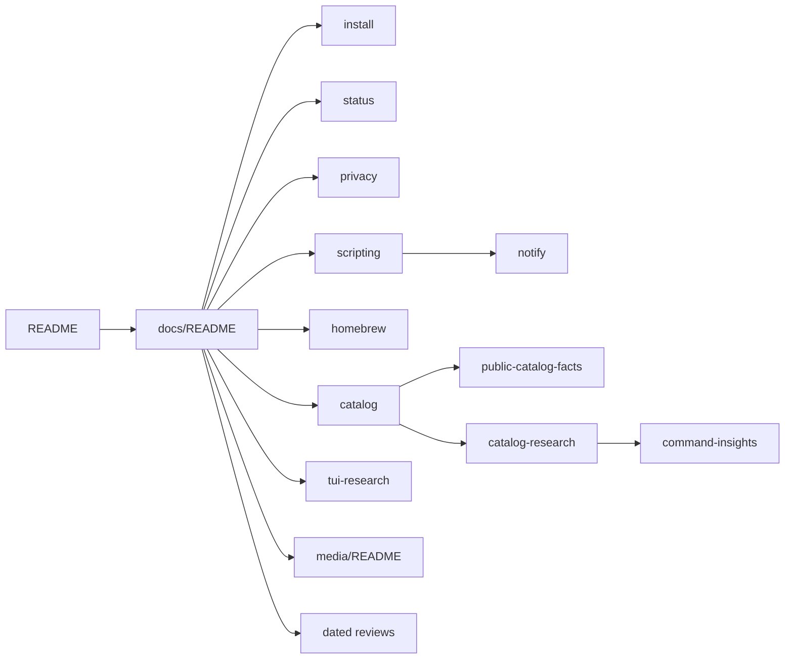

# aiup documentation

Front door for `docs/`: find the right aiup document in one read. Up: [README](../README.md). Not here: contribution rules ([CONTRIBUTING.md](../CONTRIBUTING.md)), vulnerability reporting ([SECURITY.md](../SECURITY.md)), help routing ([SUPPORT.md](../SUPPORT.md)), release history ([CHANGELOG.md](../CHANGELOG.md)).

## Routes

| Need / keywords | Open | Notes |
| --- | --- | --- |
| install, launcher, PATH, offline, uninstall, prerequisites | [install.md](install.md) | Installation contract |
| catalog list, categories, entries, counts | [catalog.md](catalog.md) | Generated by `scripts/sync-public-docs`; do not hand-edit |
| Homebrew, taps, casks, adopt, cleanup | [homebrew.md](homebrew.md) | How aiup uses Homebrew |
| privacy, scan, network requests, what stays local | [privacy.md](privacy.md) | Scanning and network boundaries |
| status, scope, version, next work, limitations | [status.md](status.md) | Current scope and completion record |
| JSON, exit status, scripts, export, import, another Mac | [scripting.md](scripting.md) | Using aiup from scripts |
| notify, notifications, cron, launchd, schedule | [notify.md](notify.md) | `aiup notify` and how to schedule it yourself |
| detected commands, ownership, version evidence | [command-insights.md](command-insights.md) | How detected commands are recognized |
| public counts, showcase, site metrics | [public-catalog-facts.md](public-catalog-facts.md) | Definitions behind published catalog numbers |
| catalog policy, candidates, managed vs detected | [catalog-research.md](catalog-research.md) | Standing catalog policy and candidate notebook |
| TUI navigation design | [tui-research.md](tui-research.md) | Picker and navigation research |
| product media, GIF, screenshots, provenance | [media/README.md](media/README.md) | Canonical media source and mirror rules |
| contributing (docs path) | [contributing.md](contributing.md) | Pointer to the root guide |

## Map

## Contents

### Use aiup

- [install.md](install.md): install, launcher, offline use and uninstall.
- [scripting.md](scripting.md): JSON output, exit status, export and import.
- [notify.md](notify.md): `aiup notify` and scheduling it yourself.
- [homebrew.md](homebrew.md): how aiup works with Homebrew.
- [privacy.md](privacy.md): what is scanned and what stays local.
- [status.md](status.md): current version, scope and next work.

### Catalog

- [catalog.md](catalog.md): generated list of catalog entries.
- [public-catalog-facts.md](public-catalog-facts.md): how published catalog numbers are counted.
- [catalog-research.md](catalog-research.md): catalog policy and candidate notebook.
- [catalog-review-2026-10-14.md](catalog-review-2026-10-14.md): the newest full catalog pass, with every addition's install channel.
- [command-insights.md](command-insights.md): how detected commands are recognized.

### Design and media

- [tui-research.md](tui-research.md): picker layout, navigation and search.
- [media/README.md](media/README.md): product media source, capture and mirror rules.
- [contributing.md](contributing.md): pointer to the root contribution guide.

### Dated reviews

Point-in-time records; they keep their original text. Newer runtime facts live in [status.md](status.md) and [catalog.md](catalog.md). The `scripts/test-*` files some of them mention were removed on 2026-10-14; git history keeps them.

| Date | Record | Scope |
| --- | --- | --- |
| 2026-08-25 | [catalog-accuracy-2026-08-25.md](catalog-accuracy-2026-08-25.md) | Accuracy audit of the 83-entry starting catalog |
| 2026-08-26 | [tui-performance-foundation-2026-08-26.md](tui-performance-foundation-2026-08-26.md) | TUI cache and snapshot foundation |
| 2026-08-26 | [tui-performance-slice-2-2026-08-26.md](tui-performance-slice-2-2026-08-26.md) | Second TUI performance slice |
| 2026-08-27 | [tui-performance-regression-closure-2026-08-27.md](tui-performance-regression-closure-2026-08-27.md) | Independent closure of the TUI performance work |
| 2026-08-27 | [dynamic-updates-category-2026-08-27.md](dynamic-updates-category-2026-08-27.md) | Virtual Updates category and bulk updating |
| 2026-09-04 | [maintenance-and-performance-2026-09-04.md](maintenance-and-performance-2026-09-04.md) | `aiup check` / `aiup explain` and efficiency review |
| 2026-09-04 | [media-and-maintenance-2026-09-04.md](media-and-maintenance-2026-09-04.md) | Category review and media maintenance |
| 2026-09-04 | [media-expansion-2026-09-04.md](media-expansion-2026-09-04.md) | Media catalog expansion |
| 2026-10-14 | [catalog-review-2026-10-14.md](catalog-review-2026-10-14.md) | 87 additions, eight new categories, held and left-out tools |

### Elsewhere in the repository

| Path | What it is |
| --- | --- |
| [`../site/README.md`](../site/README.md) | Public site at aiup.neuman.dev |
| [`../site/brand/README.md`](../site/brand/README.md) | Brand assets and provenance |
| [`../linux/README.md`](../linux/README.md), [`../windows/README.md`](../windows/README.md) | Not implemented; no support contract |
